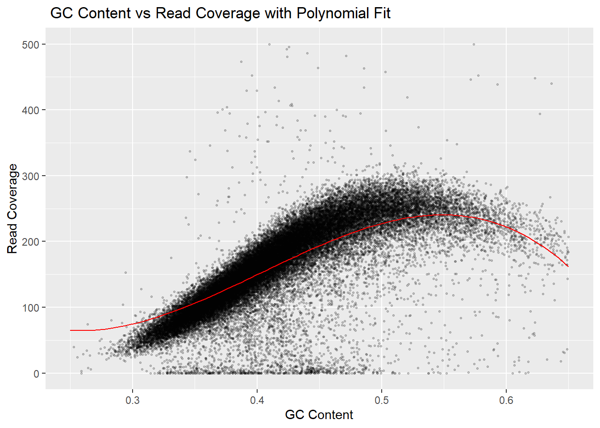
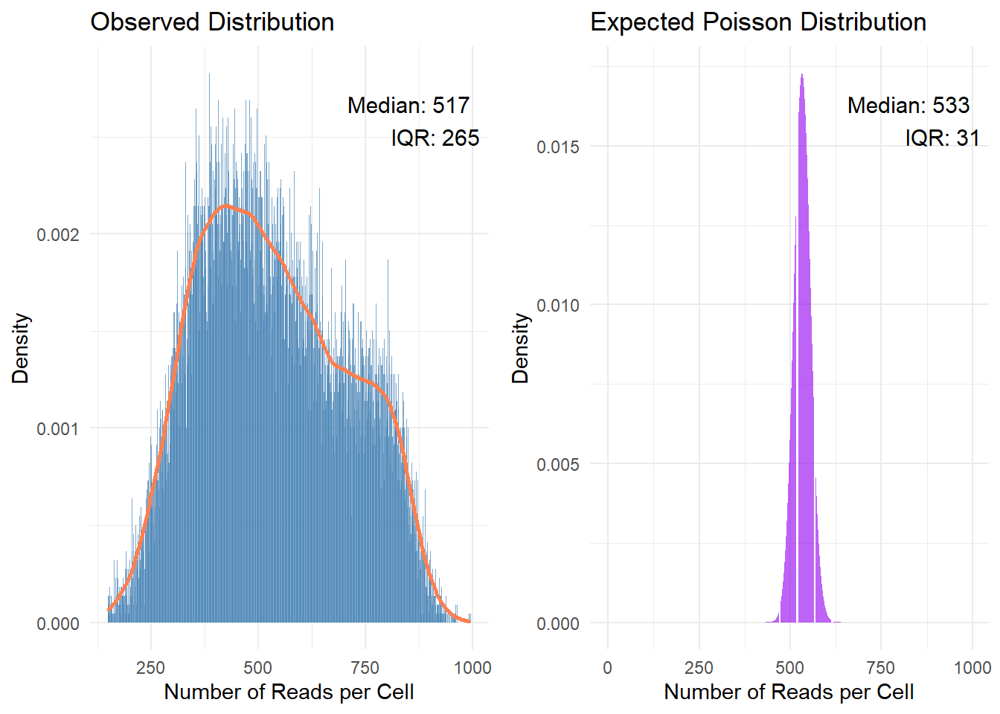
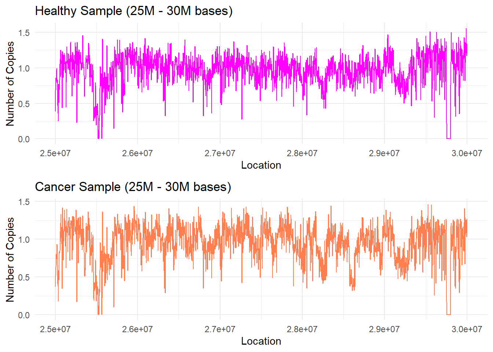

# Finding Cancer in the Genome: DNA Copy-Number Changes from Sequencing Data

**Can we tell, from raw DNA sequencing reads, where a tumour has gained or lost copies of its DNA?**

Cancer cells often carry extra or missing copies of parts of a chromosome. This project works up to detecting such changes on human **chromosome 1**, using whole-genome sequencing reads from a tumour sample and a healthy sample of the same patient (TCGA). Each step builds on the one before: how the chromosome is built, where the reads land, why they are not spread randomly, how to correct for that bias, and finally comparing the tumour with healthy tissue.



*The key obstacle: regions rich in the DNA letters G and C get systematically more sequencing reads, independent of how many copies of DNA are there. Modelling this curve (red) and removing it is what makes copy-number changes visible.*

## The steps

| # | Question | What was done | Report |
|---|---|---|---|
| 1 | What is chromosome 1 made of? | The four bases along 20 million positions: A and T appear about 10% more often than an even split would give, and C and G about 10% less | [View](https://idoshalom1997.github.io/Cancer-Genome-Copy-Number/01_base_composition.html) |
| 2 | Where do sequencing reads land? | Counting about 12 million reads along the chromosome, with a slow and a fast algorithm. About 10% of 20,000-base regions receive no reads at all | [View](https://idoshalom1997.github.io/Cancer-Genome-Copy-Number/02_mapping_reads.html) |
| 3 | Is coverage random? | Reads are compared with a uniform Poisson model. The real spread is far wider than chance would give, and coverage rises 2-3 times with GC content | [View](https://idoshalom1997.github.io/Cancer-Genome-Copy-Number/03_coverage_vs_poisson.html) |
| 4 | Modelling the GC bias | Segmented polynomial regression explains about **95%** of the variation in coverage across GC levels | [View](https://idoshalom1997.github.io/Cancer-Genome-Copy-Number/04_gc_bias_polynomial.html) |
| 5 | Splines and validation | Spline regressions with three different train/test splits of the chromosome, plus residual checks | [View](https://idoshalom1997.github.io/Cancer-Genome-Copy-Number/05_gc_bias_splines.html) |
| 6 | Estimating copy number | Each region's reads divided by what its GC content predicts: estimates sit close to the expected single copy (mean absolute deviation 0.08) | [View](https://idoshalom1997.github.io/Cancer-Genome-Copy-Number/06_read_count_model.html) |
| 7 | Cancer vs. healthy | The same analysis for a tumour and a healthy sample. GC content explains more of the variation in the tumour, as expected when copy numbers change | [View](https://idoshalom1997.github.io/Cancer-Genome-Copy-Number/07_cancer_vs_healthy.html) |
| 8 | Which estimator to trust? | Four copy-number estimators compared, from a simple median correction to a two-sample estimate with GC correction | [View](https://idoshalom1997.github.io/Cancer-Genome-Copy-Number/08_copy_number_estimators.html) |
| 9 | Two regions up close | The 25-30M and 75-80M regions of chromosome 1, compared between tumour and healthy tissue | [View](https://idoshalom1997.github.io/Cancer-Genome-Copy-Number/09_two_regions.html) |

## What we found

- **Sequencing coverage is not random.** The number of reads per region varies far more than a Poisson model allows, and most of that extra variation follows GC content.
- **The GC bias can be modelled well.** A polynomial curve captures about 95% of it, and correcting for it brings the healthy sample close to one copy everywhere.
- **Comparing tumour with healthy tissue removes false alarms.** Some regions that looked abnormal in the tumour alone, such as around position 26.8M, disappear once the healthy sample is used as a reference: they were noise.
- **One region stands out.** Around position **28.75M**, the tumour shows fewer copies than expected even after GC correction and comparison with healthy tissue, a candidate for a real copy-number loss.

| Observed coverage vs. a random (Poisson) model | Healthy vs. tumour sample, 25-30M |
|:---:|:---:|
|  |  |

## Running it

Every step is an R Markdown file in [`analysis/`](analysis), and its finished report, with all code, results and charts, is linked in the table above.

- **Steps 1, 4, 7, 8 and 9 run as they are.** The processed data they need is in [`data/`](data) (about 12 MB).
- **Steps 2, 3, 5 and 6 read the raw sequencing files** (`TCGA-13-0723-01A` tumour and `TCGA-13-0723-10B` healthy reads for chromosome 1, 180-230 MB each, plus a 90 MB chromosome sequence). These are too large for GitHub, so those steps can be read but not re-run from this repository. They expect the files in `data/raw/`.

```r
install.packages(c("ggplot2", "data.table", "tictoc", "manipulate", "tidyverse", "fitdistrplus",
                   "ggthemes", "scales", "gridExtra", "splines", "knitr", "reshape2", "rmarkdown"))
rmarkdown::render("analysis/07_cancer_vs_healthy.Rmd", knit_root_dir = getwd())
```

## Tools

R · data.table · ggplot2 · polynomial and spline regression · Poisson modelling · R Markdown

## Authors and background

A joint project by **Ido Shalom, Daniel Rodan and Sagi Levin**, built week by week between May and July 2024 during the *Statistics Lab* course at the Hebrew University of Jerusalem (B.Sc. Statistics & Data Science). Sequencing data: The Cancer Genome Atlas (TCGA), patient TCGA-13-0723.
